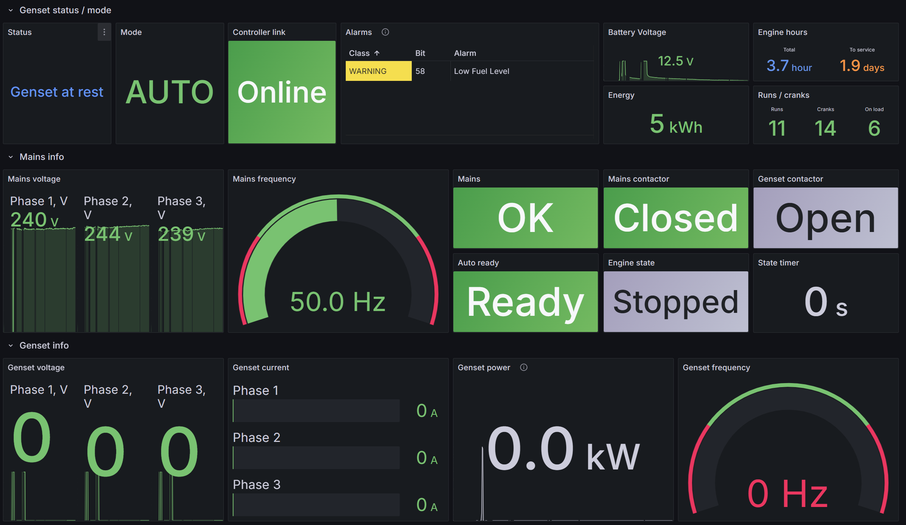
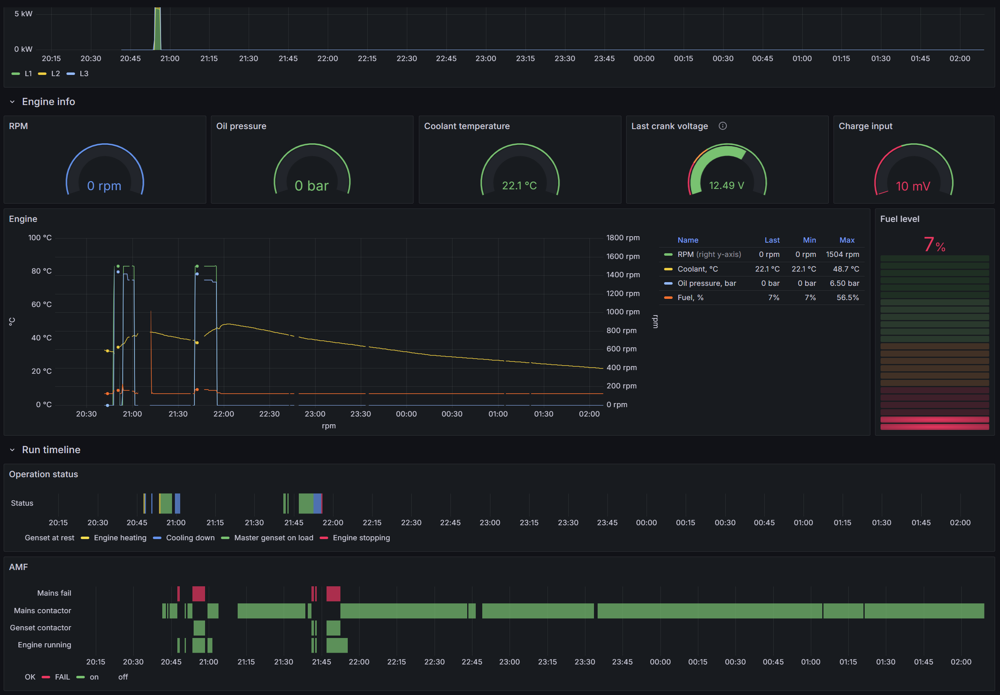

# datakom-exporter

Prometheus-експортер для контролерів генераторів **Datakom D-300 / D-500 / D-700 MK3**
(і, імовірно, D-509 MK3) через Modbus TCP. Працює як systemd-сервіс на Raspberry Pi,
Prometheus скрейпить його напряму (`/metrics`), без textfile collector.

- Протокол — бібліотека [pymodbus](https://github.com/pymodbus-dev/pymodbus) (тільки FC03,
  читання; експортер ніколи нічого не пише в контролер).
- Підтримує схеми **AMF** і **ATS** і обидва розташування трансформаторів струму — на виході
  генератора або на боці навантаження (див. нижче).
- Регістри розбиті на групи з власними інтервалами: на кожен скрейп читаються живі значення
  генератора і двигуна, мережа та прапорці стану (8 запитів), решта — рідше або
  взагалі ні; таблиці аварій — лише коли контролер сигналізує аварію (див. нижче).
- Дешборда Grafana: [dashboards/generator.json](dashboards/generator.json).
- Короткий кеш (`--min-poll-interval`, 5 с): кілька Prometheus (HA-пара) звертаються до
  контролера один раз.
- На ФС нічого не пише: ні файлів метрик, ні стану, ні кешу, ні `__pycache__`; у журнал —
  лише старт і зміни стану контролера (доступний / недоступний).

Контекст міграції D-300 → D-509, карта регістрів і перевірені факти:
[docs/GENERATOR_MODBUS_CONTEXT.md](docs/GENERATOR_MODBUS_CONTEXT.md).
Попередні версії скриптів (gist і textfile-експортер) — у [legacy/](legacy/).

## Встановлення на Raspberry Pi

```sh
git clone <repo> datakom-exporter && cd datakom-exporter
sudo ./deploy/install.sh                       # venv у /opt/datakom-exporter, systemd unit
sudo editor /etc/default/datakom-exporter      # DATAKOM_HOST=<ip контролера>
sudo systemctl restart datakom-exporter
curl -s localhost:9725/metrics | grep genset_modbus_up
```

Перед першим запуском із новим контролером перевірте ідентифікатор і порядок слів:

```sh
/opt/datakom-exporter/venv/bin/datakom-exporter probe --host <ip>
```

`probe` показує ID з регістра 10609, версії, сирі 32-бітні пари, здогадку про порядок
слів (`low_first` / `high_first`) і перевіряє правдоподібність усіх значень. Порядок слів
надійно визначається, коли є напруга (мережа або працюючий двигун).

### Збереження ресурсу SD-карти

- Сервіс (`deploy/datakom-exporter.service`) працює з `DynamicUser`, `ProtectSystem=strict`
  і без State/Cache/Logs-каталогів — запис на ФС фізично неможливий.
- `PYTHONDONTWRITEBYTECODE=1`; байт-код компілюється один раз під час `pip install`
  (`--no-cache-dir`, без pip-кешу).
- Логи: рівень WARNING, лише переходи up/down + rate limit у юніті.
- Тест `test_serving_scrapes_does_not_write_files` запускає справжній HTTP-сервер і через
  audit hook перевіряє, що жоден файл не відкривається на запис.
- Опційно для всієї системи: `Storage=volatile` у `/etc/systemd/journald.conf`
  (журнал лише в RAM) — це вже рішення для всього хоста.

## Схеми підключення: AMF і ATS, CT на генераторі або на навантаженні

Експортер не залежить від схеми: він читає ті самі регістри, а схема визначає лише, які
значення ненульові.

- **AMF** (automatic mains failure): контролер сам стежить за мережею, при її аварії запускає
  двигун і перекидає навантаження контакторами мережі й генератора. Так працює D-509 на
  об'єкті.
- **ATS** (automatic transfer switch): навантаження між мережею і генератором перекидає
  перемикач. Контролер міряє обидва джерела і показує положення контакторів; запуск може
  йти й ззовні (вхід remote start).

В обох схемах контролер міряє напругу і частоту з обох боків, а стан — у **прапорцях функцій**
(11555): `mains_fail`, `mains_contactor`, `genset_contactor`, `remote_start_input`,
`auto_ready`, `not_in_auto`, `engine_running`, зведені аварії тощо.

Де вимірюються струм, потужність, PF і kVA, залежить від того, куди поставлені трансформатори
струму (мануал D-300 MK3, розділ 5.1, параметр «CT Location»):

| CT | `source="genset"` | `source="mains"` |
|---|---|---|
| на виході генератора (`alternator`, так на D-509) | струм і потужність генератора | нулі |
| на боці навантаження (`load`) | навантаження, коли замкнений контактор генератора | навантаження, коли замкнений контактор мережі |

Експортер підтримує обидві схеми без налаштувань: струм, активна потужність (по фазах і
загальна), PF (по фазах і загальний) і kVA **обох** джерел читаються кожен скрейп (група
`live` для генератора, `mains` для мережі). Струм, потужність і PF мережі лежать у тих самих
блоках, що й генераторні, kVA мережі — +1 запит. kVAr і kWh мережі, як і kVAr генератора, — у
`extended`. На дешборді значення мережі поки не показуються.

На залізі перевірено лише AMF з CT на генераторі (D-509, 2026-11-19/20). ATS і CT на боці
навантаження підтримуються тим самим набором регістрів за 500-MODBUS, але ще не перевірені.
Правило `datakom-not-in-auto` має сенс в обох схемах: поза AUTO контролер не запустить двигун
сам.

## Конфігурація

Кожна опція — аргумент CLI або змінна оточення (`/etc/default/datakom-exporter`):

| Змінна | За замовчуванням | |
|---|---|---|
| `DATAKOM_HOST` | — (обов'язкова) | адреса контролера |
| `DATAKOM_PORT` | 502 | |
| `DATAKOM_UNIT_ID` | 1 | Modbus address контролера |
| `DATAKOM_WORD_ORDER` | `low_first` | порядок слів 32-бітних значень (D-300 MK3: `low_first`) |
| `DATAKOM_TIMEOUT` | 2 | таймаут запиту, с |
| `DATAKOM_RETRIES` | 1 | повтори pymodbus на тому самому з'єднанні; якщо й вони без відповіді — ще один повтор після перепідключення |
| `DATAKOM_REQUEST_DELAY` | 0 | пауза між блоками, с (якщо контролер не встигає) |
| `DATAKOM_LISTEN` | `:9725` | адреса HTTP |
| `DATAKOM_MIN_POLL_INTERVAL` | 5 | скрейпи в межах цього часу беруть попереднє опитування |
| `DATAKOM_GROUPS` | `live=0,mains=0,flags=0,alarms=60,counters=300,info=3600` | групи опитування та інтервали, с |
| `DATAKOM_LOG_LEVEL` | WARNING | |

### Групи опитування

Контролер віддає ≤16 регістрів за запит, тож кожна група — кілька запитів. Групи підібрані
за панелями дешборди [dashboards/generator.json](dashboards/generator.json); тест
`test_dashboard_query_has_data_with_default_groups` перевіряє, що кожен її запит має дані
з груп за замовчуванням.

| Група | Інтервал за замовч. | Запитів | Що |
|---|---|---|---|
| `live` | 0 (кожен скрейп) | 6 | генератор: U, I, kW по фазах і загальна, kVA, PF по фазах і загальний, Hz; батарея, зарядний вхід, тиск масла, температура ОР і масла, паливо, rpm, стан цифрових входів (сирий), статус, режим, таймер стану |
| `mains` | 0 (кожен скрейп) | +1 | мережа: U, Hz, I, kW і PF по фазах і загальні (у тих самих блоках, що й `live`), kVA (+1 запит); при CT на генераторі I/kW/kVA — нулі |
| `flags` | 0 (кожен скрейп) | +1 | прапорці функцій: аварія мережі, контактори, auto ready, двигун працює, зведені аварії, запити на сервіс… |
| `alarms` | 60 с | 0 / 3 | таблиці аварій shutdown / loaddump / warning — лише поки прапорець «є аварія» = 1 (див. нижче) |
| `counters` | 300 с | 3 | мотогодини, запуски, прокрутки, on-load, kWh, години до сервісу, мінімум батареї під час останньої прокрутки |
| `info` | 3600 с | 1 | ID контролера, версії HW/SW |
| `extended` | вимкнено | 6 | лінійні напруги, реактивна потужність, kVArh, години/дні від сервісу, дні до сервісу; kVAr і kWh мережі |

> **Оновлення з 0.1.x.** Струм, потужність, PF і kVA мережі (`source="mains"`) перенесено з
> групи `mains` у `extended`. Щоб і далі їх отримувати, додайте `extended=<с>` до `DATAKOM_GROUPS`.
>
> **Оновлення з 0.2.x.** `genset_power_factor` отримав мітку `phase` (`L1`–`L3`, `total`): запити
> на загальний PF — `genset_power_factor{phase="total"}`.
>
> **Оновлення з 0.3.0.** Струм, kW, PF і kVA мережі знову читаються за замовчуванням (група
> `mains`, +1 запит на скрейп), щоб підтримувати і CT на боці навантаження. Додано `genset_digital_inputs_raw` і
> `genset_battery_crank_min_volts` (+1 запит раз на 5 хв).

Приклад: `DATAKOM_GROUPS=live=0,mains=0,flags=0,alarms=60,counters=300,info=3600,extended=600`. Група, якої
немає в списку (або `=off`), ніколи не читається і не експортується. Значення повільних груп
між читаннями віддаються з кешу в пам'яті; після втрати зв'язку кеш скидається (застарілі
значення не експортуються), а після відновлення всі групи читаються одразу.
`genset_modbus_group_last_read_timestamp_seconds{group}` показує час останнього читання групи.

**Таблиці аварій за прапорцями.** Коли увімкнена група `flags`, три таблиці аварій (3 запити)
читаються лише тоді, коли прапорець `any_alarm` = 1: раз на інтервал `alarms` (60 с), навіть
якщо аварія висить довго, і одразу, коли змінюються зведені прапорці (аварія з'явилась,
зникла чи змінила клас). Друга аварія того самого класу зведених прапорців не змінює, тож її
видно з затримкою до 60 с. Без активної аварії таблиці відомі як нульові і не читаються. Без групи `flags` таблиці читаються просто за інтервалом.

**Навантаження** (симуляція реальним кодом, скрейп кожні 30 с):

| Скрейп | Без аварій | З активною аварією |
|---|---|---|
| звичайний | 8 | 8 |
| щохвилини | 8 | 11 (+3 таблиці) |
| раз на 5 хв | 11 (+3 лічильники) | 14 |
| за 5 хвилин | 83 | 98 |
| у середньому за хвилину | 16.6 | 19.6 |

При скрейпі раз на 60 с — 8.6 запиту за хвилину без аварій і 11.6 з активною аварією. Недоступний контролер коштує
один таймаут підключення, а не таймаут на кожен блок. У LAN опитування триває ≈0.1 с.

## Prometheus

```yaml
scrape_configs:
  - job_name: datakom-exporter     # правило datakom-exporter-down шукає саме цей job
    scrape_interval: 30s
    scrape_timeout: 10s
    static_configs:
      - targets: ["<raspberry-pi>:9725"]
        labels: {site: campus}
```

## Алерти

Робочі алерти — Grafana-managed правила в [alerts/generator-alerts.json](alerts/generator-alerts.json)
(формат provisioning Grafana, група "Generator (datakom-exporter)", папка "Alerts", інтервал 1 хв).
Мітка `group=power` направляє їх наявною політикою сповіщень у Telegram; `severity` — `critical`
або `warning`. Кожне правило: запит A — простий селектор `genset_*` (як у дешборді), B — `last`,
C — поріг або math-вираз Grafana. Опис посилається на панель дешборди.

| uid | Умова | for | severity |
|---|---|---|---|
| `datakom-mains-fail` | `genset_flag{flag="mains_fail"}` = 1 | 1m | critical |
| `datakom-engine-running` | `genset_flag{flag="engine_running"}` = 1 | 0 | warning |
| `datakom-genset-on-load` | `genset_flag{flag="genset_contactor"}` = 1 | 0 | warning |
| `datakom-controller-shutdown` | `genset_alarm_active{class=~"shutdown\|loaddump"}` = 1, окремий алерт на кожну аварію з її назвою (Fail To Start, Low Oil Pressure, Over Load…) | 0 | critical |
| `datakom-controller-warning` | `genset_alarm_active{class="warning"}` = 1, окремий алерт на кожне попередження з назвою (Low Fuel Level, Mains Phase Order Fail, Low Battery Voltage…) | 5m | warning |
| `datakom-not-in-auto` | `genset_flag{flag="not_in_auto"}` = 1 (автоматичний запуск не спрацює) | 15m | warning |
| `datakom-battery` | батарея поза 11.9–14.8 В | 10m | warning |
| `datakom-fuel-low` | паливо < 25 % | 10m | warning |
| `datakom-service-due` | `genset_service_hours_to{service="1"}` < 10 год (лише сервіс 1, як на дешборді) — **призупинене за замовчуванням** | 0 | warning |
| `datakom-exporter-down` | `up{job="datakom-exporter"}` = 0 або немає даних | 5m | critical |
| `datakom-controller-unreachable` | `genset_modbus_up` = 0 | 5m | critical |

Поріг батареї збігається з порогом панелі дешборди. Окремого правила на напругу мережі немає:
стан мережі визначає контролер (`datakom-mains-fail`), а саму напругу моніторять інші системи.

Призупинене за замовчуванням (`"isPaused": true` у JSON, відновлюється в UI) лише
`datakom-service-due` — нагадування про сервіс. Попередження контролера "Low Fuel Level"
(біт 58) приходить разом із `datakom-fuel-low` (поріг 25 % у Grafana).

Завантаження в Grafana (створює або замінює всю групу; потрібен токен service account з правом
на provisioning алертів):

```sh
GRAFANA_URL=https://<grafana-url> GRAFANA_TOKEN=<token> python3 alerts/upload.py
python3 alerts/upload.py --dry-run     # показати тіло запиту
python3 alerts/upload.py --paused ...  # завантажити всі призупиненими (до введення в експлуатацію)
# правила з "isPaused": true у JSON призупиняються завжди (окремим запитом на правило)
```

Правила завантажуються з `X-Disable-Provenance`, тож їх можна призупиняти в UI; джерело правди —
JSON у репо. Тест `tests/test_alerts.py` перевіряє селектори, назви прапорців і наявність даних
з груп за замовчуванням.

### Приклад для Prometheus Alertmanager

Не розгортається, лише приклад тих самих правил для Prometheus (тут умови — у PromQL). Для
kube-prometheus-stack загорніть `groups` у `PrometheusRule` (`spec.groups`, з міткою, яку вибирає
`ruleSelector`) і додайте в Alertmanager receiver і route для `group="power"`.

```yaml
groups:
  - name: datakom-exporter
    rules:
      - alert: MainsFail
        expr: genset_flag{flag="mains_fail"} == 1
        for: 1m
        labels: {group: power, severity: critical}
        annotations: {summary: "Mains fail"}
      - alert: GensetEngineRunning
        expr: genset_flag{flag="engine_running"} == 1
        labels: {group: power, severity: warning}
        annotations: {summary: "Genset engine is running"}
      - alert: GensetOnLoad
        expr: genset_flag{flag="genset_contactor"} == 1
        labels: {group: power, severity: warning}
        annotations: {summary: "Genset is on load"}
      - alert: GensetControllerShutdown
        expr: genset_alarm_active{class=~"shutdown|loaddump"} == 1
        labels: {group: power, severity: critical}
        annotations: {summary: "Controller {{ $labels.class }} alarm: {{ $labels.name }}"}
      - alert: GensetControllerWarning
        expr: genset_alarm_active{class="warning"} == 1
        for: 5m
        labels: {group: power, severity: warning}
        annotations: {summary: "Controller warning: {{ $labels.name }}"}
      - alert: GensetNotInAuto
        expr: genset_flag{flag="not_in_auto"} == 1
        for: 15m
        labels: {group: power, severity: warning}
        annotations: {summary: "Controller is not in AUTO"}
      - alert: GensetBatteryOutOfRange
        expr: genset_battery_volts < 11.9 or genset_battery_volts > 14.8
        for: 10m
        labels: {group: power, severity: warning}
        annotations: {summary: "Battery = {{ $value }} V"}
      - alert: GensetFuelLow          # поруч з аварією контролера "Low Fuel Level" (біт 58)
        expr: genset_fuel_level_percent < 25
        for: 10m
        labels: {group: power, severity: warning}
        annotations: {summary: "Fuel level {{ $value }} %"}
      - alert: GensetServiceDue
        expr: genset_service_hours_to{service="1"} < 10   # лише сервіс 1
        labels: {group: power, severity: warning}
        annotations: {summary: "Service {{ $labels.service }} due in {{ $value }} h"}
      - alert: DatakomExporterDown
        expr: up{job="datakom-exporter"} == 0 or absent(up{job="datakom-exporter"})
        for: 5m
        labels: {group: power, severity: critical}
        annotations: {summary: "datakom-exporter is down"}
      - alert: DatakomControllerUnreachable
        expr: genset_modbus_up == 0
        for: 5m
        labels: {group: power, severity: critical}
        annotations: {summary: "Datakom controller unreachable"}
```

## Метрики

Усі значення вже масштабовані (вольти, ампери, кВт, Гц, …), ділити в дашборді не треба.
Мітки: `source="mains|genset"`, `phase="L1|L2|L3|L1-L2|…|total"`.

Група кожної метрики — у `src/datakom_exporter/registers.py` (перший аргумент `_reg`).

| Метрика | Регістри | |
|---|---|---|
| `genset_voltage_ln_volts{source,phase}` | 10240–10251 | фазна напруга |
| `genset_voltage_ll_volts{source,phase}` | 10252–10263 | лінійна напруга |
| `genset_current_amperes{source,phase}` | 10264–10275 | струм |
| `genset_active_power_kilowatts{source,phase}` | 10280–10295 | активна потужність (знакова) |
| `genset_reactive_power_kilovars{source,phase}` | 10308, 10310 | |
| `genset_apparent_power_kilovoltamperes{source,phase}` | 10324, 10326 | |
| `genset_power_factor{source,phase}` | 10328–10335 | −1…1; по фазах і `phase="total"` (до 0.3 загальний був без мітки `phase`) |
| `genset_frequency_hertz{source}` | 10338, 10339 | |
| `genset_battery_volts`, `genset_charge_input_volts` | 10341, 10340 | |
| `genset_oil_pressure_bar`, `genset_coolant_temperature_celsius`, `genset_oil_temperature_celsius` | 10361, 10362, 10364 | |
| `genset_fuel_level_percent`, `genset_engine_rpm` | 10363, 10376 | |
| `genset_digital_inputs_raw` | 10373–10374 | сирий стан вбудованих цифрових входів, по 2 біти на вхід (коди в 500-MODBUS не описані; на D-509 невикористаний вхід = `11`) |
| `genset_battery_crank_min_volts` | 10385 | мінімум батареї під час останньої прокрутки (група `counters`) |
| `genset_operation_status` | 10604 | 0–25, повний список — `registers.OPERATION_STATUS` (0 at rest, 5 cranking, 8 off load, 10 transfer to genset, 13 on load, 18 transfer to mains, 22 cooling, 25 stopping…) |
| `genset_mode` | 10605 | 1 STOP, 2 RUN/MANUAL, 4 AUTO, 8 TEST |
| `genset_operation_timer_seconds` | 10606 | залишок поточного очікування (затримка аварії мережі, охолодження…) |
| `genset_flag{flag}` | 11555–11568 | 0/1, 112 названих прапорців функцій — `registers.FUNCTION_FLAGS` |
| `genset_controller_info{model,device_identity,hw_version,sw_version,word_order}` | 10609–10611 | |
| `genset_runs_total`, `genset_cranks_total`, `genset_on_load_total` | 10616–10621 | |
| `genset_engine_hours_total` | 10622 | |
| `genset_active_energy_kilowatthours_total`, `genset_reactive_energy_kilovarhours_total{kind}` | 10628–10633 | |
| `genset_service_hours_since`, `genset_service_days_since` | 10624, 10626 | |
| `genset_service_hours_to{service}`, `genset_service_days_to{service}` | 10634–10645 | від'ємні — сервіс прострочено |
| `genset_alarms{class}`, `genset_alarm_active{class,bit,name}` | 10504–10551 | `class`: shutdown / loaddump / warning; `name` — з 500-MODBUS, напр. `Low Fuel Level` |
| `genset_modbus_up`, `genset_modbus_failed_blocks`, `genset_modbus_poll_duration_seconds`, `genset_modbus_poll_timestamp_seconds` | | стан останнього опитування |
| `genset_modbus_group_last_read_timestamp_seconds{group}` | | останнє успішне читання групи |
| `genset_modbus_polls_total`, `genset_modbus_requests_total`, `genset_modbus_request_errors_total` | | |
| `genset_modbus_request_retries_total` | | загублені відповіді, відновлені перепідключенням і повтором |

### Покриття 500-MODBUS

Документ 500-MODBUS (V5.6) описує **161** читабельну величину: регістр, 32-бітну пару або масив,
як-от таблиця аварій чи буфер осцилографа, рахуються як одна. Експортер читає **75 (47 %)**,
з груп за замовчуванням — **59 (37 %)**. Аварії і прапорці покриті повністю: 3 таблиці по 142
названі біти, 112 прапорців. Журналу подій, J1939/DTC і годинника в документі немає.

| Розділ | Задокументовано | Читається | За замовч. | Чого немає і чому |
|---|---|---|---|---|
| Електрика мережі й генератора, 10240–10339 | 54 | 40 (74 %) | 32 | Q/S по фазах, струм нейтралі: низька цінність; kVAr і L-L — у `extended` (kVAr мережі коштував би +1 запит) |
| Двигун, батарея, датчики, 10340–10503 | 51 | 9 (18 %) | 9 | батарея 2, опір і другий набір датчиків, середні, гармоніки й осцилограф: на D-509 немає або дублюють наявне |
| Аварії, 10504–10551 | 3 | 3 (100 %) | 3 | — |
| Статус, режим, ID, 10604–10611 | 8 | 6 (75 %) | 6 | вихід GOV/AVR %: немає регулятора |
| Лічильники й сервіс, 10616–10645 | 15 | 15 (100 %) | 8 | kVArh, «від сервісу», дні до сервісу — у `extended` |
| Прапорці функцій, 11555 | 1 | 1 (100 %) | 1 | — |
| Енергія мережі, паливо, витратомір, 11569–11680 | 6 | 1 (17 %) | 0 | без CT мережі і витратоміра на D-509 нулі |
| LED, виходи, входи розширення, батарея 2, струм заряду | 6 | 0 | 0 | розкладка LED не задокументована, розширень немає, решта 0xFFFF |
| GPS, GPRS IP, LCD, Ethernet, MAC / UID / IMEI | 10 | 0 | 0 | немає модема; лічильники Ethernet на D-509 = 0; адреси — інфраструктура |
| Multi-genset, 11175–11378 | 7 | 0 | 0 | одиночна установка |

### Дашборда "Generator"

[dashboards/generator.json](dashboards/generator.json) — нова дешборда **"Generator
(datakom-exporter)"** з власним uid `21ec9aa7-edb0-4f77-87be-d054eb9f0b39`: імпорт створює її
поруч зі старою "Generator", не перезаписуючи її. Це стара дешборда, переведена на `genset_*` і перебудована в rows:
**Genset status / mode** (статус і режим з назвами, зв'язок з контролером, активні аварії з
назвами з 500-MODBUS, батарея, мотогодини
(загальні і до сервісу 1),
kWh, запуски / прокрутки), **Mains info** (напруга, частота, мережа OK/FAIL, контактори мережі й
генератора, auto ready, двигун, таймер стану), **Genset info** (U, I по фазах, загальна потужність, частота,
історія потужності), **Engine info** (rpm, тиск масла, ОР, напруга батареї при останній прокрутці, зарядний вхід,
паливо, графік двигуна: дві осі — °C ліворуч (ОР), rpm праворуч; тиск масла і паливо мають власні шкали
без видимих осей, щоб зберегти місце), **Run timeline** (статус
і стан AMF у часі: аварія мережі, контактори, двигун). Назви статусів і режимів на панелях
— з `registers.OPERATION_STATUS` і `MODES` (тест перевіряє збіг), назви аварій — мітка `name`
метрики `genset_alarm_active`. Зроблена зі старої версії (`legacy/grafana_gist.json`), стилі
панелей збережені. Перевірена в Grafana 11.6 на D-509 (2026-11-20). Джерело — сам JSON: правте
його (або експортуйте з Grafana після змін) і перевіряйте `pytest tests/test_groups.py`.





Знімки 2026-11-20: генератор у спокої, режим AUTO, мережа є, попередження контролера
Low Fuel Level; на часовій шкалі — два відпрацювання AMF (аварія мережі → двигун → контактор
генератора → повернення на мережу).

Кожен запит дешборди — простий селектор метрики `genset_*`, без арифметики: одиниці,
масштаб і потужність по фазах нормалізує експортер. Тест `test_dashboard_query_is_plain_exporter_metric`
падає на будь-якому `* / + sum(...)` у запиті.

Заміна запитів (для довідки):

| Було | Стало |
|---|---|
| `gen_phaseN_voltage/10` | `genset_voltage_ln_volts{source="genset",phase="LN"}` |
| `gen_phaseN_current*0.1` | `genset_current_amperes{source="genset",phase="LN"}` |
| `gen_total_active_power*0.1` | `genset_active_power_kilowatts{source="genset",phase="total"}` |
| `gen_total_apparent_power*0.1` | `genset_apparent_power_kilovoltamperes{source="genset",phase="total"}` |
| `gen_total_power_factor*0.1` (%) | `genset_power_factor{source="genset",phase="total"}` (−1…1, одиниця `percentunit`) |
| `gen_frequency/100` | `genset_frequency_hertz{source="genset"}` |
| `gen_battery_voltage/100` | `genset_battery_volts` |
| `gen_oil_pressure/10` | `genset_oil_pressure_bar` |
| `gen_engine_temp*0.1` | `genset_coolant_temperature_celsius` |
| `gen_fuel_level/10` | `genset_fuel_level_percent` |
| `gen_engine_rpm` | `genset_engine_rpm` |
| `gen_operation_status`, `gen_mode` | `genset_operation_status`, `genset_mode` (ті самі коди) |
| `gen_engine_hours_run/100` | `genset_engine_hours_total` |
| змінна `label_values(gen_mode, instance)` | `label_values(genset_mode, instance)` |

Панель "Power" (timeseries) рахувала потужність як I×U по фазах. Тепер експортер віддає
активну потужність по фазах з контролера (регістри 10280–10291):
`genset_active_power_kilowatts{source="genset",phase=~"L[123]"}` — без додаткових запитів,
ці регістри потрапляють в уже наявні блоки.

## Розробка і тести

```sh
python -m venv .venv && .venv/bin/pip install -e ".[test]"
.venv/bin/pytest            # unit + end-to-end на тестовому Modbus-сервері pymodbus
ruff check src tests
```

- `tests/modbus_sim.py` піднімає справжній Modbus TCP-сервер pymodbus (`SimDevice`) з
  регістрами з JSON-фікстури; експортер читає його по мережі, як справжній контролер.
- `tests/fixtures/*.json` — фікстури: D-300 MK3 у спокої і в охолодженні після запуску
  (реальні значення з історії Prometheus), синтетичні D-300 «запуск у TEST» і D-500
  «high word first, зворотна потужність, аварії».
- `tests/fixtures/recorded/` — сюди кладуться дампи справжніх контролерів
  (`datakom-exporter dump`), вони автоматично потрапляють у ті самі тести. Див. README там.

### Перевірка на новому контролері (D-509 MK3)

```sh
DATAKOM_LIVE_HOST=<ip> pytest -m live -v -s
# коли ID і порядок слів відомі:
DATAKOM_LIVE_HOST=<ip> DATAKOM_LIVE_IDENTITY=0xd512 DATAKOM_LIVE_WORD_ORDER=low_first pytest -m live -v
datakom-exporter dump --host <ip> --name "D-509 MK3, mains present, AUTO" --out tests/fixtures/recorded/d509mk3_auto.json
```

Перше тестування на D-509 MK3 (2026-11-19): ID `0xD512`, порядок слів `low_first`, усі блоки
читаються, 8/8 live-тестів, скрейп ≈0.83 с (≈120 мс на запит). Деталі — у
[docs/GENERATOR_MODBUS_CONTEXT.md](docs/GENERATOR_MODBUS_CONTEXT.md). Значення `0x7FFF` аналогових
датчиків (датчик не встановлений) не експортуються.

Live-тести (лише читання) перевіряють: ID у 10609, що кожен блок плану читання доступний
(немає «illegal address»), таблиці аварій, порядок слів, правдоподібність значень,
читання 1 і 16 регістрів, час опитування і повний скрейп.
